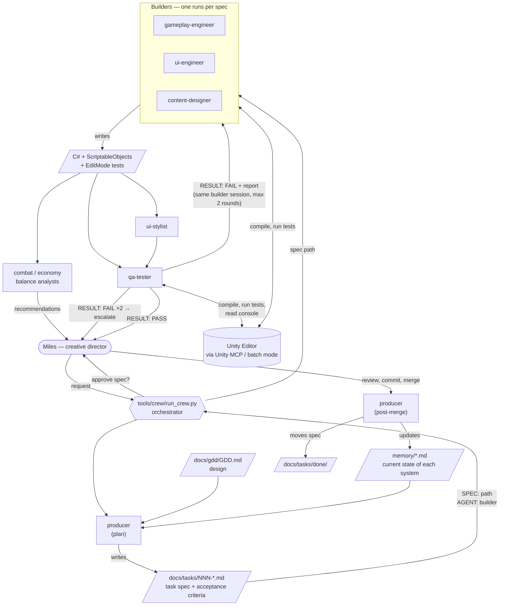

# Doom Scroller — Agent Crew

**Game:** *Doom Scroller* is a mobile RPG for iOS and Android, built in Unity 6. It plays like a
social feed: every post is an encounter. You scroll, pick a fight, and the game simulates the fight
from your loadout and replays it. It is online-only with async multiplayer. The design is in
[`docs/gdd/GDD.md`](docs/gdd/GDD.md).

**What the crew produces:** game-ready Unity features for Doom Scroller. The crew compares the GDD
against the current build, picks a gap, and writes a task spec. Then it builds the C# systems, UI,
or content data, writes and runs EditMode tests, and hands Miles (creative director) a change that
is tested and ready to merge. After Miles merges, the crew updates its own project memory so the
next task starts from the current state of the game.

## The crew

Ten agents, each defined as a Claude Code subagent in [`.claude/agents/`](.claude/agents/).
Shared rules are in [`.claude/rules/`](.claude/rules/), and each agent's limits are set in its
own definition file.

| Agent | Model | Produces |
|---|---|---|
| `producer` | opus | Task specs in `docs/tasks/`; keeps `memory/` current after merges |
| `gameplay-engineer` | sonnet | Game-system C# (combat, loot, crafting…) + tests |
| `ui-engineer` | sonnet | UGUI screens, feed features (function, not look) |
| `ui-stylist` | sonnet | Colours, fonts, layout to match `memory/ui-style.md` |
| `content-designer` | sonnet | Encounter/enemy/loot ScriptableObjects under `Assets/Resources/` |
| `combat-balance-analyst` | sonnet | Simulator-driven balance recommendations in `docs/balance/` |
| `economy-balance-analyst` | sonnet | Economy table and pricing recommendations |
| `qa-tester` | haiku | EditMode tests against acceptance criteria; PASS/FAIL report |
| `release-engineer` | sonnet | Build scripts, IAP, store material |
| `backend-engineer` | sonnet | Server, saves, server-seeded fight resolution |

## How they work together



**Data passed between agents:**

- **Request → spec.** The producer reads the GDD and `memory/systems.md` and writes one spec. The
  spec has the goal, the files the builder may read, acceptance criteria and test expectations. It
  ends with `SPEC:` and `AGENT:` lines that the orchestrator parses.
- **Spec → code.** The named builder implements only what the spec allows and compiles in Unity.
  It reports in a fixed five-line format.
- **Code → verdict.** `qa-tester` adds tests for each acceptance criterion, runs the full suite
  and ends with `RESULT: PASS|FAIL`. On FAIL the report goes back to the **same** builder session,
  so it keeps its context. After two failed rounds the orchestrator escalates to Miles.
- **Merge → memory.** After Miles merges, the producer updates `memory/` and moves the spec to
  `docs/tasks/done/`. That closes the loop for the next request.
- Optional stages: `ui-stylist` restyles after UI work. The balance analysts only recommend
  changes; they never edit game code.

**Rules the orchestrator enforces** (from [`.claude/rules/agent-workflow.md`](.claude/rules/agent-workflow.md)):
agents run one at a time, because only one Unity process can open the project. Agents never commit.
Miles approves every spec and every merge. Checks that need the Editor or a device are listed for
Miles, never claimed as verified.

## Running the crew

Requires [Claude Code](https://claude.com/claude-code) (the `claude` CLI) and Python 3. For test
runs, it also needs either Unity 6000.5.10f1 or the open Editor with the Unity MCP server.

```bash
# Full pipeline: producer plans -> pause for approval -> builder -> QA (with fix loop)
tools/crew/run_crew.py "Find one small Must-scope gap between the GDD and the build"

# Build an existing spec
tools/crew/run_crew.py --spec docs/tasks/003-some-task.md

# After Miles merges: producer updates memory and files the spec
tools/crew/run_crew.py --post-merge docs/tasks/003-some-task.md

# See the agent calls without running them
tools/crew/run_crew.py "anything" --dry-run --yes
```

Each agent runs as a headless Claude Code call (`claude -p --agent <name> --output-format json`).
Every agent's prompt and report is saved to `docs/crew-runs/<timestamp>/`.

The crew can also be driven from an interactive Claude Code session. That session acts as the
orchestrator, following the same workflow rule. The first two tasks were built that way.

## What the crew has built so far

| Task | Agents involved | Result |
|---|---|---|
| [001 Simulated win odds](docs/tasks/done/001-simulated-win-odds.md) | producer → gameplay-engineer → qa-tester → gameplay-engineer (Miles' revisions) → qa-tester → producer | `WinOddsEstimator`: 64 seeded practice fights → Likely / Risky / Long shot. Commit `ea2ffc2`. |
| [002 Feed badge tier word](docs/tasks/done/002-feed-badge-win-odds-tier.md) | producer → ui-engineer → qa-tester → producer | Feed cards show the tier word in place of the old DPS-heuristic win %. The badge is hidden on non-fight cards. Commit `7ac4e55`. |

The EditMode suite went from 97 to **135 tests, all passing**.

Running the crew also showed problems in the crew itself, which are now fixed in the agent
definitions:

- `qa-tester` had no Unity MCP tools, so it could write tests but not run them while the Editor
  was open. Its first tests also didn't compile because of a missing `using`. QA now has the MCP
  test and console tools and a step-by-step run procedure, including a rule to check each type's
  namespace.
- An MCP test run left the Editor on an empty scene, so pressing Play showed nothing. Every agent
  now checks after a test run that `SampleScene` is still open.

## Repository map

- `Assets/Scripts/` — game code (`DoomScroller.<System>` namespaces); `Assets/Tests/EditMode/` — tests
- `docs/gdd/` — game design; `docs/tasks/` — task board; `memory/` — the crew's project memory
- `.claude/agents/` — agent definitions; `.claude/rules/` — workflow and Unity conventions
- `tools/crew/run_crew.py` — orchestrator; `tools/run-editmode-tests.sh` — headless test runner
